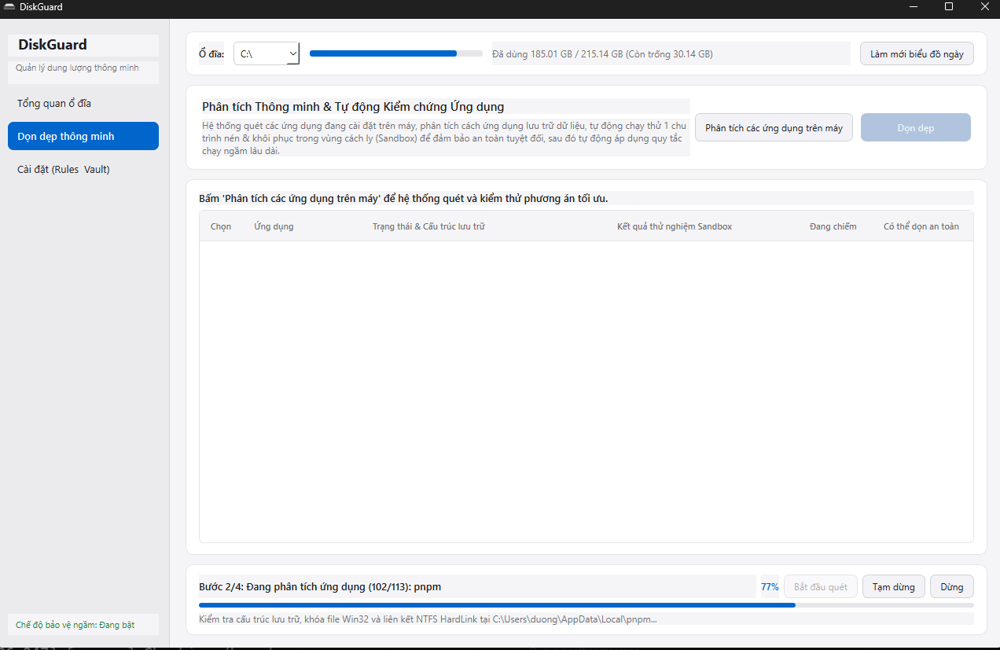

# Green C:\

Green your C drive forever. Ứng dụng Windows giữ ổ C: luôn thoáng: dọn file cũ an toàn và chuyển dữ liệu ứng dụng sang ổ khác.

Tác giả: **Cùng Chat** · [cungchat.com](https://cungchat.com)



## Tính năng

- **Tổng quan:** dung lượng ổ đĩa, biến động theo ngày, danh sách ứng dụng có thể giải phóng (bấm icon con mắt để xem bảng chi tiết).
- **Dọn dẹp:** nén file cũ không dùng tới vào Kho dự phòng (Vault) kèm SHA-256. Sau số ngày cài đặt (mặc định 7) gói nén tự xóa; trước đó có thể khôi phục. Tự bỏ qua file đang mở, file bị sửa trong lúc nén, junction.
- **Chuyển dữ liệu:** chuyển thư mục Windows (Downloads, Documents…), bộ đệm npm/pip, hướng dẫn đổi thư mục dữ liệu Zalo, hoặc chuyển thư mục ứng dụng kèm junction. Có kiểm tra sau khi chép và hoàn tác.
- **Ổ dữ liệu:** chọn ở lần chạy đầu hoặc trong Cài đặt; Vault và dữ liệu đã chuyển nằm trong `<ổ>\Green C`.
- **50 ngôn ngữ:** chọn trong Cài đặt → Ngôn ngữ (mặc định theo ngôn ngữ Windows).

## Cài đặt

Tải `GreenC-Setup-<version>.exe` ở trang [Releases](https://github.com/cungchatcom-dotcom/greenC/releases) và chạy. Bộ cài cài cho người dùng hiện tại vào `%LOCALAPPDATA%\Programs\Green C`, không cần quyền Admin. Gỡ cài đặt không xóa dữ liệu trong `%LOCALAPPDATA%\Green C` và trên ổ dữ liệu.

## Phát triển

Yêu cầu: Windows 10/11, [uv](https://docs.astral.sh/uv/).

```powershell
uv sync
uv run python main.py      # hoặc run_greenc.bat
uv run pytest -q
```

Cấu trúc: `greenc/core` (quét, nén, chuyển dữ liệu), `greenc/storage` (SQLite), `greenc/ui` (PySide6), `greenc/i18n` (bản dịch), `packaging/` (PyInstaller + Inno Setup), `scripts/` (build, version, i18n).

## Version và phát hành

Version nằm duy nhất ở `greenc/__init__.py` (`__version__`), đồng bộ với `pyproject.toml`. Theo [SemVer](https://semver.org/lang/vi/): `patch` sửa lỗi, `minor` thêm tính năng, `major` thay đổi lớn.

1. Ghi thay đổi vào mục `## [Unreleased]` trong [CHANGELOG.md](CHANGELOG.md).
2. Tăng version, commit và gắn tag:
   ```powershell
   uv run python scripts/version.py bump minor --commit --tag
   git push origin main --tags
   ```
3. GitHub Actions (`.github/workflows/release.yml`) build bộ cài và tạo Release kèm file `.exe` và `.sha256`.

Build bộ cài trên máy (cần [Inno Setup 6](https://jrsoftware.org/isinfo.php): `winget install JRSoftware.InnoSetup`):

```powershell
powershell -ExecutionPolicy Bypass -File scripts\build.ps1   # -SkipTests để bỏ qua test
# -> dist\GreenC-Setup-<version>.exe
```

## Dịch thuật

Chuỗi giao diện viết bằng tiếng Việt và bọc trong `tr()` (`from greenc.i18n import tr`). Bản dịch ở `greenc/i18n/locales/<mã>.json`.

```powershell
uv run python scripts/i18n.py extract   # cập nhật greenc/i18n/messages.json sau khi sửa chữ
uv run python scripts/i18n.py check     # liệt kê chuỗi thiếu dịch / sai biến {…}
```

Test `tests/test_i18n.py` sẽ báo lỗi nếu còn chuỗi chưa dịch ở bất kỳ ngôn ngữ nào.
