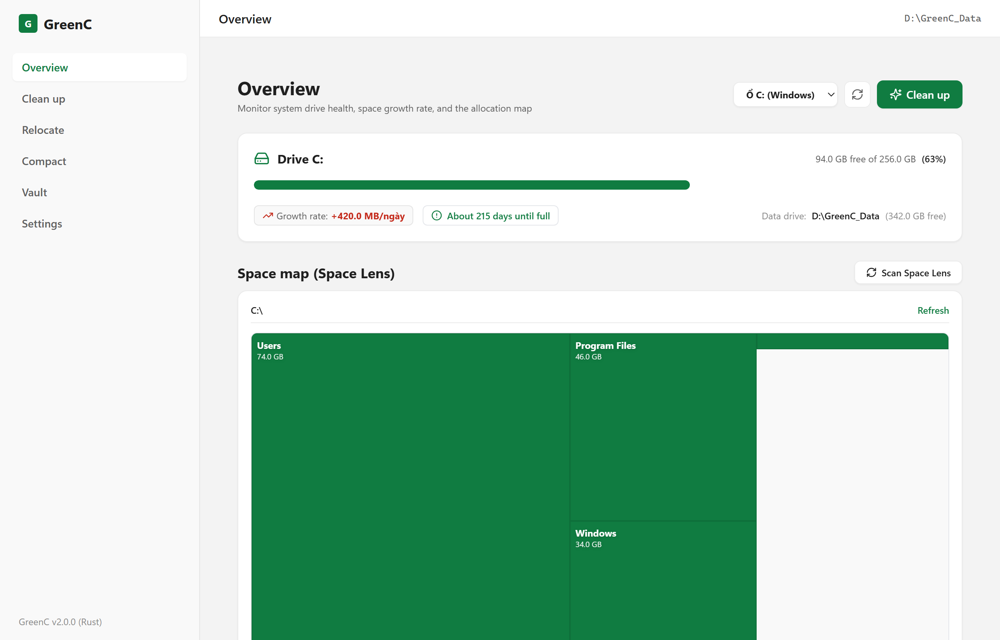
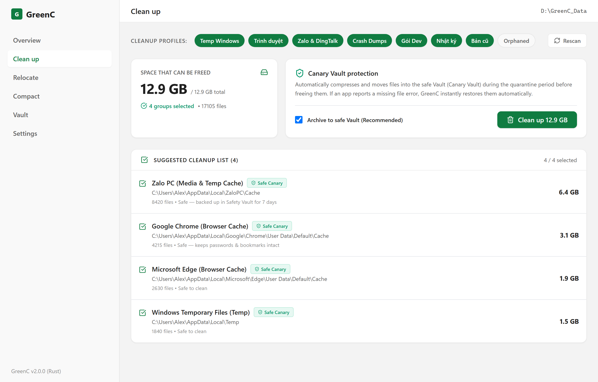
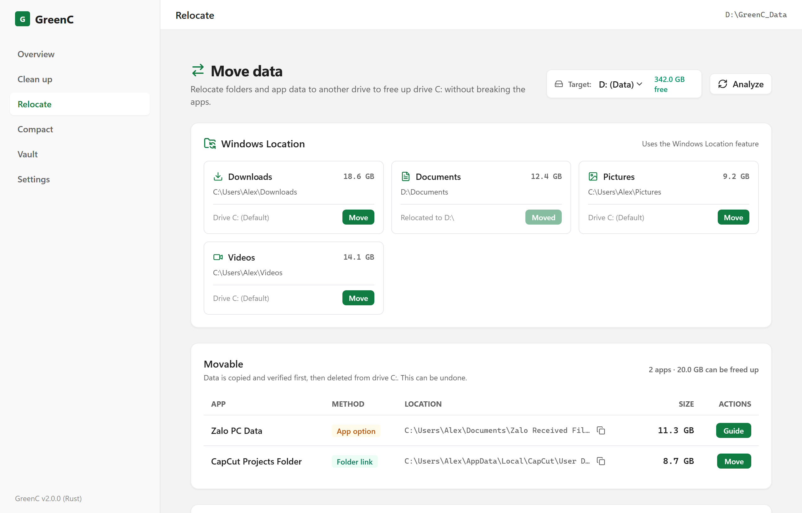
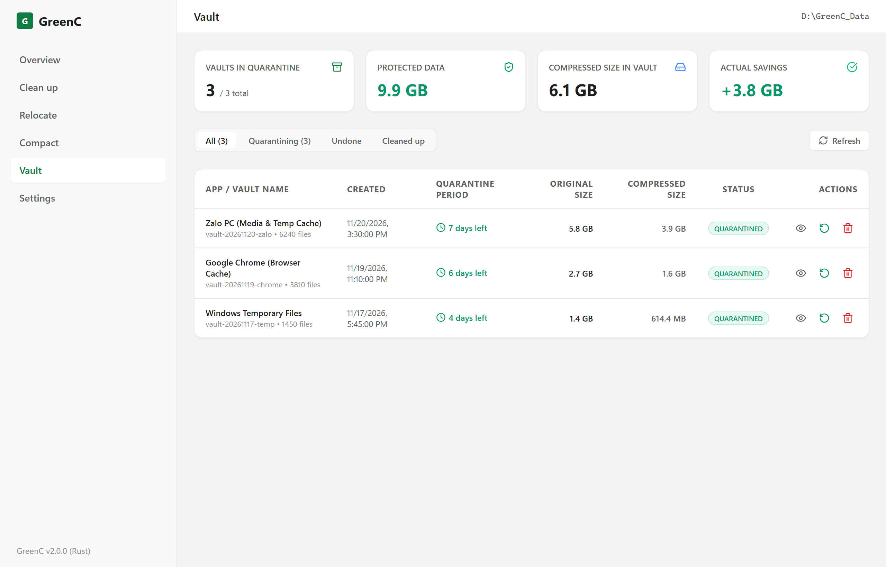
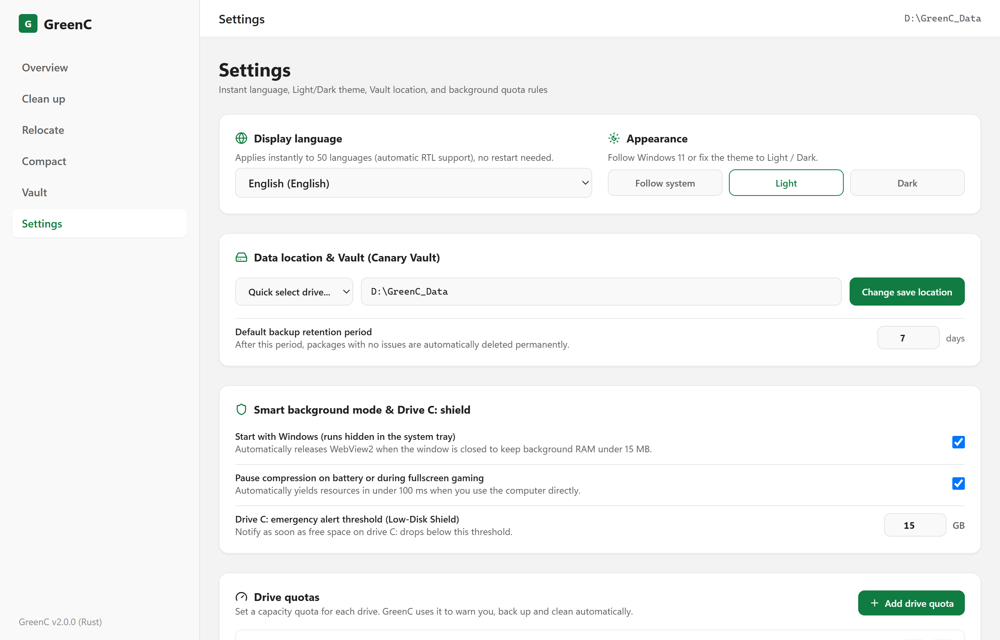

# GreenC

**Set your drive limit once. Keep drive C: green every day.**

**English** | [Tiếng Việt](README.vi.md)

- **Official Website & Download:** https://greenc.cungchat.com
- **Platform:** Windows 10 / 11 (64-bit)
- **Version:** 2.0.0 (Rust + Tauri v2 + Svelte 5)
- **Languages:** English & Vietnamese
- **License:** [PolyForm Noncommercial License 1.0.0](LICENSE)

---

**GreenC** is a lightweight, 100% local Windows application built by [CungChat](https://cungchat.com) that keeps your C: drive healthy automatically. Just pick your maximum drive limit once — GreenC deep-analyzes what is filling up drive C:, clears temporary junk safely, compresses backups into a 7-day **Safety Vault**, and protects your drive every day.

## Key Highlights

- **Set your limit once:** Define a capacity threshold per drive; the 45-second background guardian watches over drive C: automatically.
- **Deep cleanup, ~4.5× faster archiving:** Finds temporary clutter from Zalo PC, Chrome, Edge, and Windows Temp, compressing 11,900 files (1.4 GB) in ~100 seconds.
- **7-day Canary Safety Vault:** Cleaned files are never lost immediately — they are compressed into a ZIP64 backup on drive D: so you can restore individual files or entire cleanups in one click.
- **Safe relocation to drive D:**: Move `Downloads`, `Documents`, `Pictures`, `Videos`, and large app folders off drive C: without breaking apps, with full undo support.
- **Tiny RAM & installer footprint:** 5.6 MB Windows installer (no administrator rights needed) and **< 15 MB RAM** while minimized to the system tray.
- **Private by design:** Runs 100% locally on your PC — zero personal files are ever uploaded.
- **2 Languages:** Built-in **English** and **Vietnamese** with instant live switching.

---

## Features & Screenshots

### 1. Overview & Space Lens
Monitor C: drive free space, daily growth rate, days remaining before full, and inspect the interactive **Space Lens** treemap to spot large folders immediately.



### 2. Smart Junk Cleanup
Automatically detects reclaimable caches from Zalo PC, Chrome, Edge, and Windows Temp with real-time progress and Safety Vault backup enabled by default.



### 3. Safe Relocation to Drive D:
Relocate Windows Known Folders and heavy app directories to drive D: seamlessly, with one-click undo and link health checks.



### 4. Canary Safety Vault (7-Day Backup)
Inspect quarantined ZIP64 archives stored on your secondary drive and restore any file or full backup in one click.



### 5. Settings & Per-Drive Quotas
Switch between **English** and **Vietnamese**, choose your backup drive and retention days, and configure per-drive storage limits.



---

## System Architecture

[](docs/architecture.html)

> Interactive Archify diagram: open [`docs/architecture.html`](docs/architecture.html) locally in any browser.

### Repository Structure

| Directory | Description |
|---|---|
| `crates/greenc-core` | Core domain types, config, `TaskControl` (pause/resume/cancel), error handling |
| `crates/greenc-win32` | Safe RAII wrappers around Windows APIs (file locks, Restart Manager, NTFS Junctions, Known Folders, WOF compaction, single-instance mutex) |
| `crates/greenc-storage` | Embedded SQLite WAL database (`rusqlite`), schema migrations, Vault path repair |
| `crates/greenc-i18n` | English & Vietnamese localization with instant live switching |
| `crates/greenc-scanner` | Multi-threaded `rayon` disk scanner, Space Lens treemap, daily growth & forecast |
| `crates/greenc-vault` | Parallel ZIP64 archiver, Canary probe, selective restore & auto-rollback watchdog |
| `crates/greenc-relocate` | Multi-strategy folder relocation (Known Folders, app configs, guided moves, NTFS junctions) & compaction |
| `crates/greenc-cli` | Headless CLI for diagnostics, automation, and JSON config export/import |
| `crates/greenc-app` & `ui/` | Tauri v2 + Svelte 5 desktop app with 45s `BackgroundGuardian` & low-RAM tray mode |

---

## Download

Get the free official Windows installer (`GreenC-Setup-2.0.0.exe`, 5.6 MB) at **[https://greenc.cungchat.com](https://greenc.cungchat.com)** (requires a free CungChat account).

---

## Build from Source

Requirements: Windows 10/11 (64-bit), Rust `1.83+`, Node.js `20+`, pnpm `10+`.

```powershell
pnpm --dir ui install
cargo test --workspace
pnpm --dir ui build
cargo run -p greenc-app
```

---

## License

GreenC is distributed under the **[PolyForm Noncommercial License 1.0.0](LICENSE)** (`PolyForm-Noncommercial-1.0.0`).

- **Permitted:** Free for personal use, education, research, modification, and sharing for **any noncommercial purpose**.
- **Restricted:** Commercial use, resale, paid services, or commercial bundling require separate written permission.

For commercial licensing or support, contact **cungchat.com@gmail.com**.
