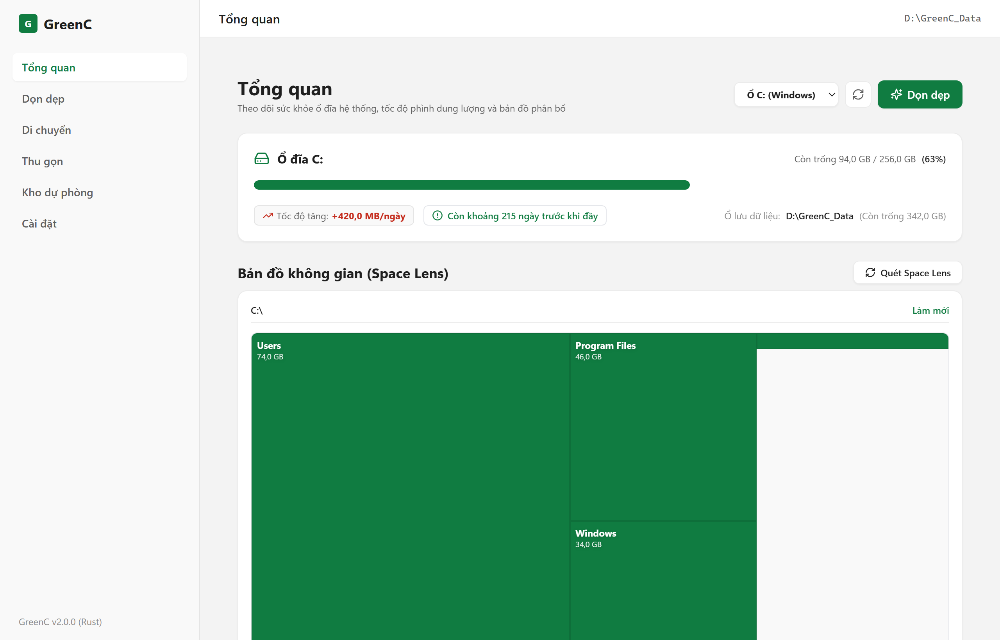
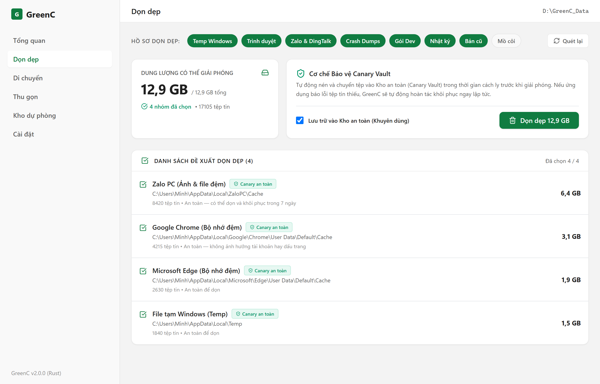
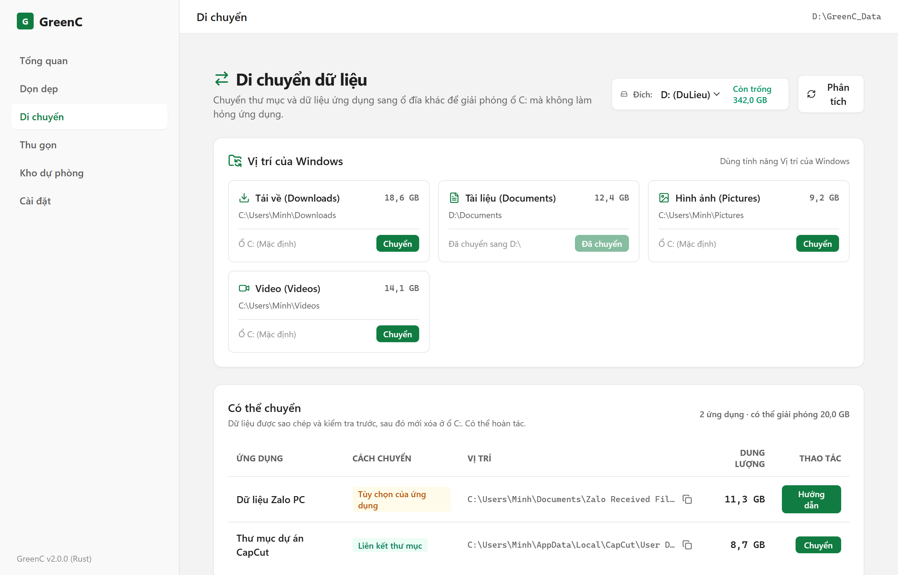
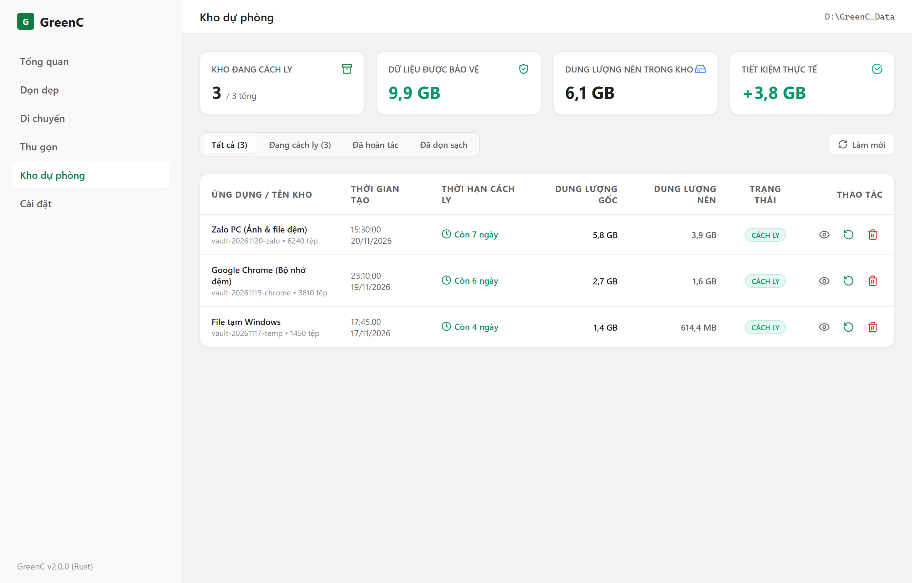
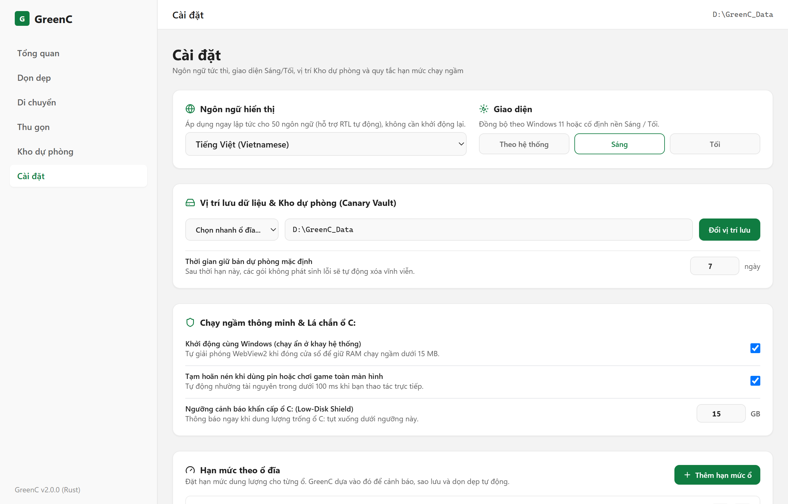
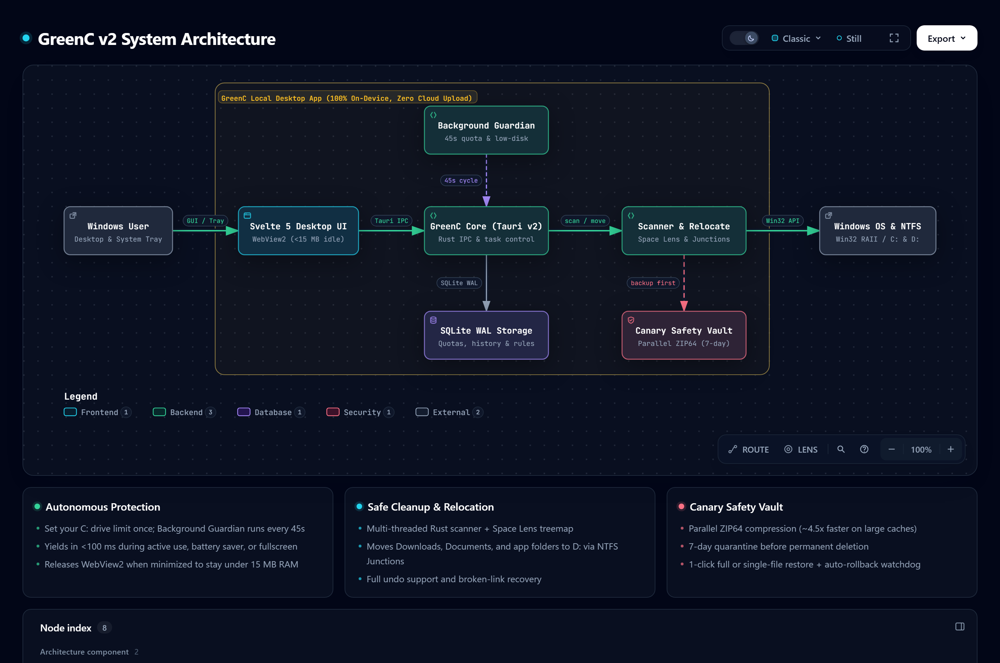

# GreenC

**Đặt hạn mức một lần. Giữ ổ C luôn xanh mỗi ngày.**

[English](README.md) | **Tiếng Việt**

- **Trang chủ & Tải về:** https://greenc.cungchat.com
- **Nền tảng:** Windows 10 / 11 (64-bit)
- **Phiên bản:** 2.0.0 (Rust + Tauri v2 + Svelte 5)
- **Ngôn ngữ:** Tiếng Việt & English
- **Giấy phép:** [PolyForm Noncommercial License 1.0.0](LICENSE)

---

**GreenC** là ứng dụng dọn dẹp và bảo vệ ổ C gọn nhẹ, chạy 100% cục bộ trên Windows, phát triển bởi [Cùng Chat](https://cungchat.com). Chỉ cần đặt hạn mức tối đa cho ổ đĩa một lần — GreenC sẽ tự động phân tích sâu, dọn sạch file rác, nén lưu vào **Kho an toàn 7 ngày** và bảo vệ ổ C của bạn mỗi ngày.

## Điểm nổi bật

- **Đặt hạn mức một lần:** Thiết lập ngưỡng dung lượng tối đa cho từng ổ đĩa; bộ bảo vệ chạy ngầm (chu kỳ 45 giây) tự động canh giữ ổ C mỗi ngày.
- **Tự động phân tích sâu & dọn nhanh gấp ~4,5 lần:** Phát hiện bộ nhớ đệm từ Zalo PC, Chrome, Edge, Windows Temp; nén sao lưu 11.900 file (1,4 GB) chỉ trong ~100 giây.
- **Kho an toàn 7 ngày (Canary Safety Vault):** Không xóa vĩnh viễn ngay lập tức — file đã dọn được nén gọn thành gói ZIP64 trên ổ D để bạn khôi phục lẻ từng file hoặc cả gói chỉ bằng 1 cú bấm.
- **Di chuyển thư mục sang ổ D an toàn:** Chuyển `Downloads`, `Documents`, `Pictures`, `Videos` và dữ liệu ứng dụng nặng sang ổ D mà không làm hỏng phần mềm, có nút hoàn tác bất cứ lúc nào.
- **Tốn cực ít RAM & cài siêu nhanh:** Bộ cài chỉ 5,6 MB (không cần quyền Admin) và chạy ngầm dưới khay hệ thống tốn **< 15 MB RAM**.
- **Riêng tư tuyệt đối:** Mọi thứ xử lý hoàn toàn trên máy tính của bạn, không tải dữ liệu cá nhân lên mạng.
- **Hỗ trợ 2 ngôn ngữ chính:** **Tiếng Việt** và **English**, chuyển đổi trực tiếp không cần khởi động lại.

---

## Tính năng & Ảnh chụp màn hình thực tế

### 1. Tổng quan & Bản đồ dung lượng (Space Lens)
Theo dõi dung lượng trống ổ C, tốc độ tăng mỗi ngày, dự báo số ngày trước khi đầy và xem bản đồ **Space Lens** để biết ngay thư mục nào chiếm chỗ nhiều nhất.



### 2. Dọn dẹp file rác thông minh
Tự động quét file tạm từ Zalo PC, Chrome, Edge và Windows Temp kèm tiến trình trực tiếp và chế độ sao lưu vào Kho an toàn bật sẵn.



### 3. Di chuyển dữ liệu sang ổ D an toàn
Chuyển các thư mục Windows quen thuộc và thư mục ứng dụng nặng sang ổ D nhẹ nhàng, giữ nguyên cách mở file và hỗ trợ hoàn tác 1 chạm.



### 4. Kho an toàn 7 ngày (Canary Safety Vault)
Xem danh sách các gói ZIP64 đang lưu dự phòng trên ổ D và khôi phục lại bất kỳ file nào chỉ với 1 cú bấm.



### 5. Cài đặt đơn giản & Hạn mức theo ổ đĩa
Đổi ngôn ngữ **Tiếng Việt / English** trực tiếp, chọn ổ D lưu Kho dự phòng, chỉnh số ngày giữ bản lưu và đặt hạn mức cho từng ổ đĩa.



---

## Kiến trúc hệ thống

[](docs/architecture.html)

> Sơ đồ Archify tương tác: mở trực tiếp file [`docs/architecture.html`](docs/architecture.html) trên trình duyệt để phóng to và xem chi tiết từng thành phần.

### Cấu trúc mã nguồn

| Thư mục | Vai trò |
|---|---|
| `crates/greenc-core` | Kiểu dữ liệu cốt lõi, cấu hình, bộ điều phối `TaskControl` (tạm dừng/tiếp tục/hủy), xử lý lỗi |
| `crates/greenc-win32` | Tầng bọc RAII an toàn cho Windows API (khóa tệp, Restart Manager, NTFS Junction, Known Folders, nén WOF, khóa đơn phiên bản) |
| `crates/greenc-storage` | Cơ sở dữ liệu SQLite WAL nhúng (`rusqlite`), nâng cấp lược đồ, sửa đường dẫn Kho dự phòng |
| `crates/greenc-i18n` | Đa ngôn ngữ **Tiếng Việt** & **English**, chuyển đổi trực tiếp |
| `crates/greenc-scanner` | Bộ quét ổ đĩa đa luồng `rayon`, bản đồ Space Lens, lịch sử tăng trưởng và dự báo đầy ổ đĩa |
| `crates/greenc-vault` | Nén ZIP64 song song, kiểm tra Canary, khôi phục lẻ từng file & tự động hoàn tác |
| `crates/greenc-relocate` | Chuyển dữ liệu đa chiến lược (Known Folders, cấu hình ứng dụng, hướng dẫn, NTFS Junction) & thu gọn tệp |
| `crates/greenc-cli` | Công cụ dòng lệnh chẩn đoán, tự động hóa và xuất/nhập quy tắc JSON |
| `crates/greenc-app` & `ui/` | Ứng dụng Desktop Tauri v2 + Svelte 5 tích hợp `BackgroundGuardian` (45 giây) & chế độ khay hệ thống tiết kiệm RAM |
| `web/` | Trang giới thiệu chính thức & cổng tải xác thực tài khoản Cùng Chat (`greenc.cungchat.com`) |

---

## Tải về

Tải bộ cài đặt Windows chính thức miễn phí (`GreenC-Setup-2.0.0.exe`, chỉ 5,6 MB) tại **[https://greenc.cungchat.com](https://greenc.cungchat.com)** *(yêu cầu tài khoản Cùng Chat miễn phí)*.

---

## Tự build từ mã nguồn

Yêu cầu: Windows 10/11 (64-bit), Rust `1.83+`, Node.js `20+`, pnpm `10+`.

```powershell
# Ứng dụng Desktop
pnpm --dir ui install
cargo test --workspace
pnpm --dir ui build
cargo run -p greenc-app

# Trang Landing Page (web/)
npm --prefix web install
npm --prefix web run build
node web/server.mjs
```

---

## Giấy phép sử dụng

GreenC được phát hành theo giấy phép **[PolyForm Noncommercial License 1.0.0](LICENSE)** (`PolyForm-Noncommercial-1.0.0`).

- **Được phép:** Sử dụng miễn phí cho mục đích cá nhân, học tập, nghiên cứu, chỉnh sửa và chia sẻ lại cho **mọi mục đích phi thương mại**.
- **Không được phép (khi chưa có sự đồng ý bằng văn bản):** Kinh doanh, bán lại, phân phối thu phí hoặc đóng gói thương mại.

Liên hệ cấp phép thương mại hoặc hỗ trợ: **cungchat.com@gmail.com**.
