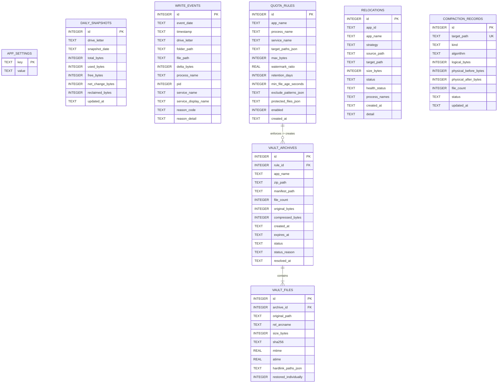

# Phase 1 Data Model: GreenC v2 (SQLite WAL + Rust Domain Types)

**Feature**: `001-greenc-complete-platform`
**Database Path**: `%LOCALAPPDATA%\GreenC\greenc.db` (auto-migrated from `%LOCALAPPDATA%\Green C\greenc.db` and legacy `C:\DiskGuard\data\diskguard.db`)
**Journal Mode**: `PRAGMA journal_mode = WAL; PRAGMA foreign_keys = ON; PRAGMA synchronous = NORMAL;`

---

## 1. Entity-Relationship Overview

---

## 2. Entities, Fields & Validation Rules

### 2.1 `app_settings` (`AppSettings`)
Key-value store for user preferences.

| Key | Value Format | Default | Validation Rule |
|-----|--------------|---------|-----------------|
| `data_root` | UTF-8 absolute path (e.g. `D:\GreenC`) | `""` (triggers First-Run) | Must reside on a fixed writable NTFS volume |
| `retention_days_default` | Integer string | `"7"` | Clamped to `1..=90` |
| `language` | BCP-47 underscore code (`vi`, `en`, `zh_CN`, `ar`…) | `""` (OS locale match) | Must be in the 50-code `LANGUAGE_CODES` catalog |
| `theme_mode` | `"system" \| "light" \| "dark"` | `"system"` | Enum validated |
| `autostart_enabled` | `"0" \| "1"` | `"0"` | Syncs `HKCU\Software\Microsoft\Windows\CurrentVersion\Run\GreenC` |
| `low_disk_shield_gb` | Integer string | `"10"` | Clamped to `2..=100` GiB |
| `pause_on_battery_fullscreen` | `"0" \| "1"` | `"1"` | Boolean string |

---

### 2.2 `daily_snapshots` (`DailySnapshot`)
Captures per-drive daily usage and powers the 7/14/30-day chart + Burn-Rate Forecast.

| Field | SQLite Type | Rust Type | Constraints / Notes |
|-------|-------------|-----------|---------------------|
| `id` | `INTEGER PRIMARY KEY AUTOINCREMENT` | `Option<i64>` | Auto ID |
| `drive_letter` | `TEXT NOT NULL` | `String` | Normalized uppercase root (`"C:\\"`, `"D:\\"`). `UNIQUE(drive_letter, snapshot_date)` |
| `snapshot_date` | `TEXT NOT NULL` | `NaiveDate` (`YYYY-MM-DD`) | Local calendar date |
| `total_bytes` | `INTEGER NOT NULL` | `u64` | `> 0` |
| `used_bytes` | `INTEGER NOT NULL` | `u64` | `<= total_bytes` |
| `free_bytes` | `INTEGER NOT NULL` | `u64` | `total_bytes - used_bytes` |
| `net_change_bytes` | `INTEGER NOT NULL DEFAULT 0` | `i64` | Signed delta vs previous snapshot (`+` growth, `-` freed) |
| `reclaimed_bytes` | `INTEGER NOT NULL DEFAULT 0` | `u64` | *(v2 migration)* Bytes freed by GreenC on this date |
| `updated_at` | `TEXT NOT NULL` | `DateTime<Local>` | ISO-8601 seconds |

---

### 2.3 `write_events` (`WriteEvent`)
Per-day drill-down ledger attributing disk growth/shrinkage to folders, processes, and services.

| Field | SQLite Type | Rust Type | Constraints / Notes |
|-------|-------------|-----------|---------------------|
| `id` | `INTEGER PRIMARY KEY AUTOINCREMENT` | `Option<i64>` | Auto ID |
| `event_date` | `TEXT NOT NULL` | `String` (`YYYY-MM-DD`) | Indexed with `drive_letter` (`idx_events_drive_date`) |
| `timestamp` | `TEXT NOT NULL` | `String` | ISO-8601 |
| `drive_letter` | `TEXT NOT NULL` | `String` | Normalized `"C:\\"` |
| `folder_path` | `TEXT NOT NULL` | `String` | Summarized bucket path |
| `file_path` | `TEXT NOT NULL` | `String` | Representative file path |
| `delta_bytes` | `INTEGER NOT NULL` | `i64` | Signed (`>= 64 KiB` threshold for aggregated scan events) |
| `process_name` | `TEXT NOT NULL` | `String` | Executable name or inferred owner |
| `pid` | `INTEGER NOT NULL DEFAULT 0` | `u32` | `0` when attributed offline |
| `service_name` | `TEXT NOT NULL DEFAULT ''` | `String` | Windows Service short name (e.g., `wuauserv`) |
| `service_display_name` | `TEXT NOT NULL DEFAULT ''` | `String` | Localized/friendly service or app label |
| `reason_code` | `TEXT NOT NULL` | `WriteReasonCode` | Enum: `MEDIA_CHAT`, `EAPP_BUNDLE`, `CACHE_TEMP`, `OLD_APP_VERSION`, `CRASH_DUMP`, `LOG_GROWTH`, `DB_STORAGE`, `CONTAINER_VM`, `MEDIA_DOWNLOAD`, `APP_DATA`, `ORPHAN_LEFTOVER` |
| `reason_detail` | `TEXT NOT NULL` | `String` | Localized description + file count |

---

### 2.4 `quota_rules` (`QuotaRule`)
Rolling soft-quota configuration enforced manually or every 45s in the background.

| Field | SQLite Type | Rust Type | Constraints / Notes |
|-------|-------------|-----------|---------------------|
| `id` | `INTEGER PRIMARY KEY AUTOINCREMENT` | `Option<i64>` | `0` reserved in `vault_archives.rule_id` for ad-hoc 1-click cleanups without a rule |
| `app_name` | `TEXT NOT NULL` | `String` | Non-empty display name |
| `process_name` | `TEXT NOT NULL DEFAULT ''` | `String` | Optional `.exe` name |
| `service_name` | `TEXT NOT NULL DEFAULT ''` | `String` | Watched by `SafetyWatchdog` for unexpected `stopped` transitions |
| `target_paths_json` | `TEXT NOT NULL` | `Vec<PathBuf>` | JSON array of target directories |
| `max_bytes` | `INTEGER NOT NULL` | `u64` | `>= 1 MiB` |
| `watermark_ratio` | `REAL NOT NULL DEFAULT 0.85` | `f64` | `0.10..=0.95` (default `0.85`) |
| `retention_days` | `INTEGER NOT NULL DEFAULT 7` | `u32` | `1..=90` |
| `min_file_age_seconds` | `INTEGER NOT NULL DEFAULT 60` | `u64` | `>= 0` (default `60`) |
| `exclude_patterns_json` | `TEXT NOT NULL DEFAULT '[]'` | `Vec<String>` | Combined with `DEFAULT_PROTECTED_PATTERNS` |
| `protected_files_json` | `TEXT NOT NULL DEFAULT '[]'` | `Vec<String>` | Auto-populated permanently whenever a file is rolled back |
| `enabled` | `INTEGER NOT NULL DEFAULT 1` | `bool` | `0` or `1` |
| `created_at` | `TEXT NOT NULL` | `String` | ISO-8601 |

---

### 2.5 `vault_archives` & `vault_files` (`VaultArchive`, `VaultFileItem`)

**State Transitions (`VaultArchive.status`)**:
- `QUARANTINED` → `ROLLED_BACK` (via Auto-Rollback on unsafe condition OR Manual 1-click Restore)
- `QUARANTINED` → `PURGED` (via Auto-Purge when `now >= expires_at` with zero errors OR Manual Delete Now)

`vault_files` includes `hardlink_paths_json` (`Vec<String>` of all sibling paths sharing the same NTFS File ID) and `restored_individually` (`0/1`, added in Schema v2 for Granular Single-File Restore while keeping the remaining archive `QUARANTINED`).

---

### 2.6 `relocations` (`RelocationRecord`)

**Strategies (`RelocationStrategyKind`)**:
- `"known_folder"` | `"tool_config"` | `"guided"` | `"junction"`

**State Machine (`RelocationRecord.status`)**:
- `"moving"` (written *before* `os.rename(src, src.greenc-moving)` so power loss is recoverable on next boot)
  - → `"done"` (after junction/config verified and `.greenc-moving` cleaned)
  - → `"failed"` (after atomic rollback restores `src` and deletes partial `target`)
- `"done"` → `"undone"` (after verified copy back to `C:` + junction/config removal)

**Health Status (`health_status`, added in Schema v2)**:
- `"healthy"` | `"target_offline"` (secondary drive unplugged) | `"link_broken"` (reparse point removed/retargeted externally).

---

### 2.7 `compaction_records` (`CompactionRecord` — New in Schema v2)
Tracks in-place transparent NTFS/WOF cold compression and `.vhdx` virtual disk compactions.

| Field | SQLite Type | Rust Type | Constraints / Notes |
|-------|-------------|-----------|---------------------|
| `id` | `INTEGER PRIMARY KEY AUTOINCREMENT` | `Option<i64>` | Auto ID |
| `target_path` | `TEXT NOT NULL UNIQUE` | `PathBuf` | Directory or `.vhdx` path on `C:` |
| `kind` | `TEXT NOT NULL` | `CompactionKind` | `"wof_directory"` \| `"vhdx_trim"` |
| `algorithm` | `TEXT NOT NULL` | `String` | `"XPRESS8K"` \| `"XPRESS16K"` \| `"LZNT1"` \| `"VIRTDISK"` |
| `logical_bytes` | `INTEGER NOT NULL` | `u64` | Uncompressed logical size |
| `physical_before_bytes` | `INTEGER NOT NULL` | `u64` | Allocated size on disk prior to compaction |
| `physical_after_bytes` | `INTEGER NOT NULL` | `u64` | Allocated size on disk after compaction |
| `file_count` | `INTEGER NOT NULL DEFAULT 1` | `u64` | Files compacted |
| `status` | `TEXT NOT NULL` | `String` | `"compacted"` \| `"decompressed"` |
| `updated_at` | `TEXT NOT NULL` | `String` | ISO-8601 |
